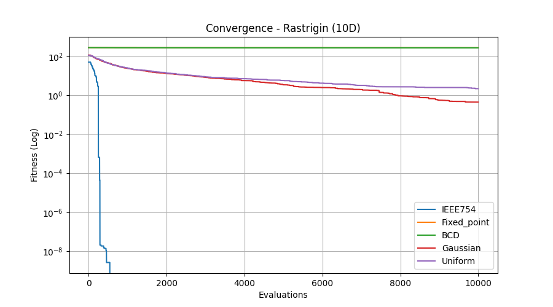
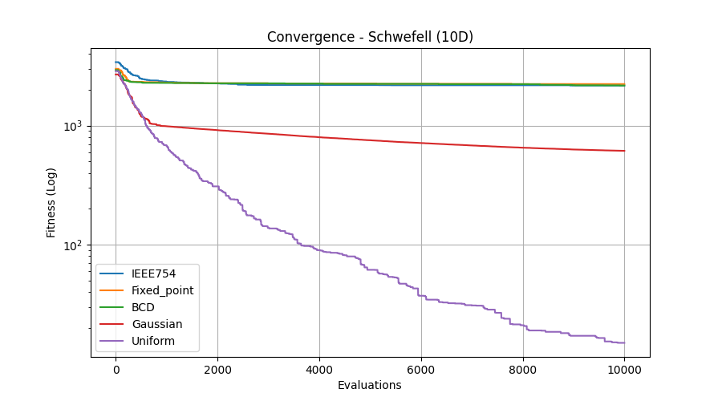
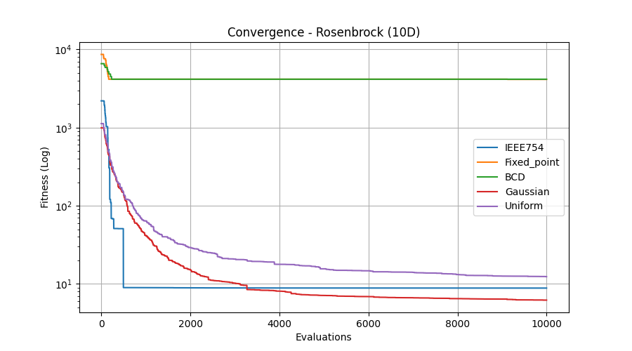

# Genetický algoritmus - reálné parametry

## Varianty v reálné doméně

### Gaussova mutace
Plynule konverguje k minimu a dosáhla nejlepších výsledků u funkcí Rosenbrock a Rastrigin.

### Uniformní mutace
Tato náhodná mutace dosáhla nejlepších výsledků u funkce Schwefel. U Rastrigin a Rosenbrock nebyla tak dobrá jako Gaussova mutace.

## Binární reprezentace
### Fixed point a BCD
Tyto dvě varianty byly ze všech metod nejhorší a nedokázaly konvergovat k lepším řešením. To může být způsobeno Hammingovými útesy, kdy u sousedních čísel se mění mnoho bitů např. 15 a 16 v desítkové soustavě (01111 | 10000).

### IEEE 754
Tato reprezentace se chovala velmi odlišně pro různé funkce. U funkce Rastrigin došlo k velmi rychlé konvergenci, což může být způsobeno tím, že mutace jednoho bitu v exponentu způsobí obrovský skok o několik řádů a algoritmus to vyhodnotí jako dokonalé řešení.
U Schwefela se jednalo o nejhorší řešení.
U Rosenbrock se to blíží řešení Gaussově a uniformní mutaci.

Obecně z grafů vyplývá, že genetické algoritmy v reálné doméně dosahují lepších výsledků než metody využívající překódování do binární reprezentace.

