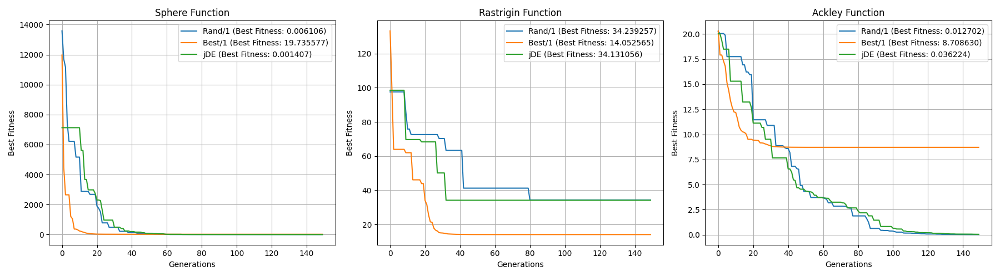

# Diferenciální evoluce

## Funkce Sphere
Varianta Best/1 má v prvních 10 generacích extrémní pokles, protože funkce nemá lokální minima. Docela brzy dochází ke konvergenci.
Varianty Rand/1 a jDE postupují pomaleji, ale dosahují lepších výsledků blízkých nule.

## Funkce Rastrigin
Varianta Best/1 díky nejlepšímu jedinci dosáhne nižší hodnoty fitness než ostatní varianty.
Všechny varianty uvíznou v lok. minimu Rastriginovy funkce mezi 30-80 generacemi.

## Funkce Ackley
Varianta Best/1 uvízla po 30ti generacích v lokálním minimu, zatímco Rand/1 a jDE v dalších generacích stále nacházely lepší řešení až do 120. generace.

